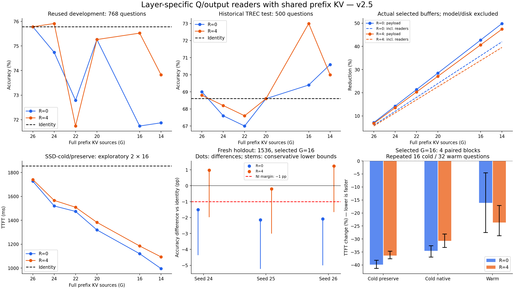

# 跨层共享 prefix KV v2.5：范围扩展与原生块保留实验

已完成 G=26、24、22、20、16、14 × R=0/4 的全部 12 个配置；最广配置有 14 个消费者读取跨层共享 prefix KV。按预先写定的开发集规则选择 G16，保留 R0/R4 两条路线，分别训练种子 24、25、26，再评估从未参与本轮选择的 1536 条留出数据。

固定种子24的新留出准确率：无共享 73.24%，R0 71.74%，R4 74.22%。R4 实际 selected prefix KV 减少 40.63%，计入 reader/packed 后这部分净减少 33.88%。

R0/R4 三种子准确率均值分别为 71.33% / 73.91%；R4 相对同种子 R0 的差为 2.47pp, 1.95pp, 3.32pp。这些是同一留出题集上的三次训练结果，不能按4608个独立问题计算置信区间。

历史完整 TREC 500 条，固定种子24：无共享 343/500（68.60%），G16/R4 365/500（73.00%）。

SSD-cold/native，R4：2045.01 → 1417.24 ms，变化 -30.70%，探索性块区间 [-33.28, -28.08]%；4轮重复同16题，不能视为完整数据集的独立请求统计。
SSD-cold/preserve，R4：1802.65 → 1147.36 ms，变化 -36.35%，探索性块区间 [-37.61, -34.71]%；4轮重复同16题，不能视为完整数据集的独立请求统计。

独立留出集三种子非劣验收：**两条路线均未做到三个固定种子全部通过。** 所有 checkpoint 仍标注 diagnostic，不自动替换原系统。v2.4 的验收失败不被本轮覆盖。

## 1. 范围、实现与可比性

Qwen2.5-7B-Instruct / RTX 3090，28 层，28 个 Q head、4 个 KV head、head dim 128；prefix 4940 token，块大小 16，预算 25%，P8 周期 8。主干冻结。各层正常产生 Q；消费者通过本层 Q 变换读取源层 prefix KV，再对聚合输出做本层变换。当前 query 与生成 token 的 KV 始终逐层独立，28 层计算均保留。

R=4：只从该层原本已选中的物理块中，把最后 4 块划为本层原生保留区；剩余部分走共享读取器。短末块使实际保留长度通常为 60 token，不能描述成新增 64 token 的滑动窗口。共享前段通过源缓冲区前缀视图读取，本层小块与私有 query/tail 拼接，仍由两个 attention 分支联合归一化；没有重建完整消费者 prefix KV。缓存准入仅接收消费者的小块 IDs。

实现为附加 v25 模块；v24 的 FA2/LSE-aware 反向、实际候选续写评分损失、推理内核和冷状态判定均保留。安装时 11 个基础接口哈希匹配；运行后再次核对。旧版→新版 identity 和旧 G26 读取器桥接各 8 条的首 token 全词表 logits、标签逐 token logprob、选择计划均精确一致。R4 实际在线与训练回放的初始 8 条冒烟验证：token 误差为 0，平均标签分数最大差约 4.77e-7。

| 完整来源数 G | 共享消费者数 | 实际 source→consumer（0-based） |
| --- | --- | --- |
| 26 | 2 | 26→25,27 |
| 24 | 4 | 22→21,23；26→25,27 |
| 22 | 6 | 18→17,19；22→21,23；26→25,27 |
| 20 | 8 | 14→13,15；18→17,19；22→21,23；26→25,27 |
| 16 | 12 | 6→5,7；10→9,11；14→13,15；18→17,19；22→21,23；26→25,27 |
| 14 | 14 | 2→1,3；6→5,7；10→9,11；14→13,15；18→17,19；22→21,23；26→25,27 |

G14 涉及 7 组三层共享，共 21 层参与；其余 7 层原生读取。它不是所有层读取单一 KV。R4 还存在 14 份小型原生保留区，完整来源数 G 也不是总恢复调用次数。

## 2. 数据、训练与事先选择规则

拟合 64 条、校准验证 64 条复用既有 teacher；开发 768 条为此前已观察数据，仅做研究筛选。所有图/R/种子使用同一个冻结 v24 seed24 初始化，200 步、每 25 步校准验证；按相同目标选最佳步数，不以真实最终留出集选模型。R0/R4 的初始张量哈希逐一相同。

完整 TREC test500 是历史回归集。新 final1536 从 TREC train5500 未使用余集中固定种子抽取，排除旧训练/验证/开发/留出、prefix 示例及 test500 的规范化文本重复，模型 token hash 再查重。它是同任务新留出样本，不是新的官方 benchmark。每条数据只在质量统计中计一次，重复计时不扩大质量样本量。另附历史 test500 排除既有 5 个 prefix 重叠题后的 strict495。

选择规则：G24/22/20/16/14 中，只要同一 G 的任一 R 在开发集准确率距 contemporaneous identity 不低于 1 个百分点，就进入候选，选其中最小 G；若全部不满足，固定回退到 G24 诊断。实际选择 G16，fallback=False。该点估计筛选不是非劣验收。两条 R 均保留，补种子 25/26，6 个 checkpoint 的 SHA 在 final1536 前冻结。

最终非劣容许差为 −1pp；每条 R 使用 alpha=0.025 的保守有害/有益翻转二项界，两条路线做 Bonferroni，且各自要求三个固定种子全部通过。没有挑选最好种子；开发网格和历史500的区间只作描述。

校准回放使用教师的固定选择计划；实际质量评估使用在线 P8 选择器。共享改变后续层输入后，也可能改变后续选择结果。配对 JSON 中的 selection_plan_exact_agreement 是完整计划哈希一致率，不是 token Jaccard，不能据此直接推断 token 重合比例。

## 3. 全覆盖质量曲线

无共享：开发 75.78%，历史500 68.60%。以下均 seed24。

| G | R | 开发768准确率% | 历史500准确率% | 历史正确数 | 历史相对差pp | 开发候选KL |
| --- | --- | --- | --- | --- | --- | --- |
| 26 | 0 | 75.78 | 69.00 | 345 | 0.40 | 0.00398 |
| 26 | 4 | 75.78 | 68.80 | 344 | 0.20 | 0.00374 |
| 24 | 0 | 74.74 | 67.60 | 338 | -1.00 | 0.02059 |
| 24 | 4 | 75.91 | 68.20 | 341 | -0.40 | 0.01474 |
| 22 | 0 | 72.79 | 67.00 | 335 | -1.60 | 0.08534 |
| 22 | 4 | 71.74 | 67.60 | 338 | -1.00 | 0.10763 |
| 20 | 0 | 75.26 | 68.60 | 343 | 0.00 | 0.14945 |
| 20 | 4 | 75.26 | 68.60 | 343 | 0.00 | 0.13826 |
| 16 | 0 | 71.74 | 69.40 | 347 | 0.80 | 0.26709 |
| 16 | 4 | 75.52 | 73.00 | 365 | 4.40 | 0.27088 |
| 14 | 0 | 71.88 | 70.60 | 353 | 2.00 | 0.31578 |
| 14 | 4 | 73.83 | 70.00 | 350 | 1.40 | 0.25226 |

候选 KL 是完整标签续写平均 logprob 经 softmax 构造的辅助分布，既不是首 token 全词表 KL，也不是校准后的类别概率。局部校准误差降低不能替代上述真实分类结果。所有扩大范围配置均如实保留，没有因掉点删除。

## 4. 新留出 1536：固定三种子

无共享正确 1125/1536，准确率 73.24%。

| R | 种子 | 正确数 | 准确率% | 有害翻转 | 有益翻转 | 差pp | 保守单侧下界pp | −1pp非劣 |
| --- | --- | --- | --- | --- | --- | --- | --- | --- |
| 0 | 24 | 1102 | 71.74 | 109 | 86 | -1.50 | -4.34 | 未通过 |
| 0 | 25 | 1092 | 71.09 | 131 | 98 | -2.15 | -5.20 | 未通过 |
| 0 | 26 | 1093 | 71.16 | 118 | 86 | -2.08 | -4.98 | 未通过 |
| 4 | 24 | 1140 | 74.22 | 96 | 111 | 0.98 | -1.96 | 未通过 |
| 4 | 25 | 1122 | 73.05 | 94 | 91 | -0.20 | -2.98 | 未通过 |
| 4 | 26 | 1144 | 74.48 | 89 | 108 | 1.24 | -1.63 | 未通过 |

同一固定种子内，R4 相对 R0 的描述性对照如下；不额外宣称经过多重比较修正的优效验收。

| 种子 | R4相对R0准确率差pp | R0正确→R4错误 | R0错误→R4正确 |
| --- | --- | --- | --- |
| 24 | 2.47 | 41 | 79 |
| 25 | 1.95 | 46 | 76 |
| 26 | 3.32 | 50 | 101 |

本轮质量结论只覆盖 TREC 完整标签续写分类评分；多 token 私有 KV 审计验证运行语义，不等于自由生成质量评测。

## 5. 实际资源：完整源 + 原生保留区 + 读取器

| G | R | 源KV MiB | 保留KV MiB | selected减少% | reader含packed MiB | selected+reader净减少% | 恢复调用数 |
| --- | --- | --- | --- | --- | --- | --- | --- |
| 26 | 0 | 62.58 | 0.00 | 7.12 | 0.76 | 5.99 | 26 |
| 26 | 4 | 62.58 | 0.23 | 6.77 | 0.76 | 5.65 | 28 |
| 24 | 0 | 57.78 | 0.00 | 14.24 | 1.52 | 11.99 | 24 |
| 24 | 4 | 57.78 | 0.47 | 13.54 | 1.52 | 11.29 | 28 |
| 22 | 0 | 52.98 | 0.00 | 21.36 | 2.27 | 17.98 | 22 |
| 22 | 4 | 52.98 | 0.70 | 20.32 | 2.27 | 16.94 | 28 |
| 20 | 0 | 48.19 | 0.00 | 28.48 | 3.03 | 23.98 | 20 |
| 20 | 4 | 48.19 | 0.94 | 27.09 | 3.03 | 22.59 | 28 |
| 16 | 0 | 38.59 | 0.00 | 42.72 | 4.55 | 35.97 | 16 |
| 16 | 4 | 38.59 | 1.41 | 40.63 | 4.55 | 33.88 | 28 |
| 14 | 0 | 33.80 | 0.00 | 49.84 | 5.30 | 41.96 | 14 |
| 14 | 4 | 33.80 | 1.64 | 47.40 | 5.30 | 39.53 | 28 |

口径是请求 selected 缓冲区。净减少另计常驻/packed reader；不包含主干权重、索引/selector、allocator保留、临时小块拼接和私有KV。持久化原始KV未删除，不能据此声称模型总显存或磁盘占用下降相同比例。R4 小缓冲区占用与恢复开销已实测计入；实际CPU/SSD/H2D流量另见 profiler，不等于这张逻辑/物理缓冲表。

## 6. TTFT：顺序配对、认证冷缓存

每个正式 arm 使用新进程，模型/内核先预热 8 次；冷请求前只清理本轮自有目标 prefix cache，并通过原控制器检查 GPU/CPU payload 空、无未完成请求、文件页 mincore 全不驻留，再计时到首 token logits 就绪。这里认证的是应用缓存和 OS 文件页冷态，不包含 SSD 控制器内部缓存。冷状态准备时间不计入 TTFT，模型启动不计入 TTFT。未清空全系统 page cache，也未触碰其他用户 GPU 作业。质量并行运行的 TTFT 不用于速度结论。

preserve 指受测文件读取时不主动追加原 native 路径的文件缓存驱逐；native 保留原系统 advice 行为。二者都在每个受测请求开始前认证目标文件页全冷，不能把 preserve 当成暖缓存。

| G | R | 无共享ms | 共享ms | 变化% |
| --- | --- | --- | --- | --- |
| 26 | 0 | 1853.71 | 1726.88 | -6.84 |
| 26 | 4 | 1853.71 | 1740.57 | -6.10 |
| 24 | 0 | 1853.71 | 1520.03 | -18.00 |
| 24 | 4 | 1853.71 | 1566.57 | -15.49 |
| 22 | 0 | 1853.71 | 1474.41 | -20.46 |
| 22 | 4 | 1853.71 | 1509.31 | -18.58 |
| 20 | 0 | 1853.71 | 1319.75 | -28.80 |
| 20 | 4 | 1853.71 | 1382.96 | -25.40 |
| 16 | 0 | 1853.71 | 1120.63 | -39.55 |
| 16 | 4 | 1853.71 | 1185.29 | -36.06 |
| 14 | 0 | 1853.71 | 996.32 | -46.25 |
| 14 | 4 | 1853.71 | 1094.08 | -40.98 |

上表仅 2 个整网格正序/倒序块，每块同一组 16 题，是覆盖曲线诊断。两个块不足以给出强稳定性结论；不把 32 次重复请求当成 32 个独立质量样本。

| 选择 G16 的场景 | R | 无共享ms | 共享ms | 变化% | 块bootstrap 95%范围% |
| --- | --- | --- | --- | --- | --- |
| preserve | 0 | 1802.65 | 1084.54 | -39.84 | [-41.27, -38.17] |
| preserve | 4 | 1802.65 | 1147.36 | -36.35 | [-37.61, -34.71] |
| native | 0 | 2045.01 | 1337.71 | -34.59 | [-36.95, -32.59] |
| native | 4 | 2045.01 | 1417.24 | -30.70 | [-33.28, -28.08] |
| warm | 0 | 254.52 | 213.54 | -16.10 | [-27.50, -4.54] |
| warm | 4 | 254.52 | 194.33 | -23.65 | [-28.75, -17.11] |

负值为降低。各场景 4 个顺序平衡块，冷每块16题、暖每块32题，主计时固定seed24。selected preserve 的前两块来自整网格、后两块是选定三臂，因此时间段和调度范围有差异。仅4块的重复查询区间是探索性区间；应连同 JSON 中每块的方向检查，不宣称覆盖所有工作负载的稳定收益。

正式冷状态认证：704 个请求全部通过；每个首decoder阶段 process write_bytes=0。冷准备开销与进程 read_bytes 逐臂保存在结果 JSON。

## 7. Nsight / VizTracer / 恢复路径

| 场景 | 请求数 | profiled TTFT ms | H2D MB | H2D累计ms | GPU busy union ms |
| --- | --- | --- | --- | --- | --- |
| nsys_native_identity | 8 | 2076.36 | 135.10 | 9.34 | 38.91 |
| nsys_native_shared | 8 | 1403.68 | 89.90 | 6.47 | 37.25 |
| nsys_preserve_identity | 8 | 1583.56 | 135.10 | 9.33 | 38.72 |
| nsys_preserve_shared | 8 | 1058.10 | 89.90 | 6.46 | 37.12 |
| nsys_warm_identity | 8 | 301.00 | 20.10 | 1.01 | 30.94 |
| nsys_warm_shared | 8 | 223.74 | 6.69 | 0.35 | 31.10 |

这里仅 8 条 profiler 请求，范围为准确 TTFT/logits_ready NVTX；H2D 含 payload、选择索引及元数据。GPU累计时间、API等待、NVTX嵌套区间可能重叠，不能直接相加构造关键路径。Profiler会扰动执行，不能替代上一节正式计时。

冷态硬件 H2D 字节减少 33.45%，暖态减少 66.72%。冷态 H2D 累计时间只减少 2.87 ms，远小于正式 native TTFT 的平均降幅 627.78 ms。

结合恢复路径的文件访问减少，这支持主机数据恢复、缓存管理和等待是主要收益来源；不能把 H2D 省时单独解释成全部加速。Profiler 中 GPU busy union 未见同量级变化。由于各阶段有重叠且 profiler 样本较小，这属于有实测支撑的机制解释，不是精确关键路径分解。

VizTracer native_identity 主线程 self 时间前五项（每次首次 prefill，ms）：

- `to`：1047.26
- `wait`：287.39
- `__new__`：207.13
- `uncache`：94.17
- `to`：38.73

VizTracer native_shared 主线程 self 时间前五项（每次首次 prefill，ms）：

- `to`：698.92
- `wait`：238.53
- `__new__`：122.61
- `uncache`：54.66
- `decoder_logits`：31.11

VizTracer warm_identity 主线程 self 时间前五项（每次首次 prefill，ms）：

- `wait`：51.65
- `decoder_logits`：40.67
- `select_promixed_gqa_blocks`：23.82
- `configure_impress_layer`：22.08
- `_logical_segment`：17.60

VizTracer warm_shared 主线程 self 时间前五项（每次首次 prefill，ms）：

- `decoder_logits`：30.32
- `wait`：23.28
- `select_promixed_gqa_blocks`：21.27
- `configure_impress_layer`：19.49
- `_logical_segment`：11.85

VizTracer self 包含未追踪 C/库函数和阻塞等待，各线程重叠；所有4个trace均完整、无overflow。SSD prefetch/promotion 的调用、文件访问与耗时诊断另存 results/v25_final_analysis.json 的 restore_diagnostic，不能把嵌套耗时相加。

| 恢复策略/配置 | 请求数 | 预取文件数/请求 | 晋升文件数/请求 | 每路径请求文件内容 MB |
| --- | --- | --- | --- | --- |
| native_identity | 8 | 4326 | 4326 | 70.65 |
| native_r0 | 8 | 2478 | 2478 | 40.47 |
| native_shared | 8 | 2574 | 2574 | 41.94 |
| preserve_identity | 8 | 4326 | 4326 | 70.65 |
| preserve_r0 | 8 | 2478 | 2478 | 40.47 |
| preserve_shared | 8 | 2574 | 2574 | 41.94 |

同一文件可能在预取和晋升两条路径重复访问。表内文件内容字节数是调用所请求的文件大小，不能当成硬件 SSD 读取量或 H2D 量；实际进程 read_bytes 和 CUPTI 传输另行记录。文件访问与缓存管理减少为延迟收益提供了直接机制证据，但各阶段仍可能重叠。

## 8. 训练成本与摊销

| 配置 | 最佳步 | 总墙钟秒（含加载/验证） | 峰值allocated GiB | 校准候选KL |
| --- | --- | --- | --- | --- |
| v25_g14_r0_s24 | 200 | 743.28 | 14.72 | 0.20802 |
| v25_g14_r4_s24 | 200 | 774.60 | 14.72 | 0.26491 |
| v25_g16_r0_s24 | 200 | 685.98 | 14.71 | 0.21666 |
| v25_g16_r0_s25 | 75 | 681.12 | 14.71 | 0.20132 |
| v25_g16_r0_s26 | 200 | 705.76 | 14.71 | 0.23807 |
| v25_g16_r4_s24 | 200 | 691.55 | 14.71 | 0.25933 |
| v25_g16_r4_s25 | 200 | 686.00 | 14.71 | 0.24504 |
| v25_g16_r4_s26 | 175 | 716.39 | 14.71 | 0.22304 |
| v25_g20_r0_s24 | 200 | 557.25 | 14.69 | 0.16963 |
| v25_g20_r4_s24 | 200 | 560.27 | 14.69 | 0.16896 |
| v25_g22_r0_s24 | 200 | 495.78 | 14.68 | 0.07016 |
| v25_g22_r4_s24 | 125 | 520.13 | 14.68 | 0.05580 |
| v25_g24_r0_s24 | 100 | 458.66 | 14.67 | 0.01672 |
| v25_g24_r4_s24 | 100 | 452.49 | 14.67 | 0.01218 |
| v25_g26_r0_s24 | 200 | 378.92 | 14.66 | 0.00313 |
| v25_g26_r4_s24 | 200 | 382.35 | 14.66 | 0.00351 |

G16 R0：用 observed SSD-cold/preserve 平均差估算，当前训练加继承父reader训练的摊销请求数 约 1512。
G16 R4：用 observed SSD-cold/preserve 平均差估算，当前训练加继承父reader训练的摊销请求数 约 1665。

以上仅训练成本示意，不含教师采集、12配置搜索、数据准备、额外种子与选择成本，不是总成本 break-even 保证；速度差存在有限样本不确定性。14B 未运行：本轮单卡24GiB、BF16权重与当前执行器不具备适配后的可比14B路径。

## 9. 审计、测试和复现

完整 GPU 回归：547 passed, 4 skipped, 1 warning, 87 subtests passed in 11.34s。

重新核对 4025 个既有受保护文件，变更数 0；原 prism_pans 目录没有本轮修改。实际在线审计覆盖源指针视图、R4原生值与存储一致、支持集不增不减、缓存准入仅小块、28层私有KV独立并生成多token。另有 G14/R4 单请求预检：14 个消费者、532 次 attention 调用、19 次 decoder 调用全部通过，私有缓存增长 15 token。最终两个R的在线/回放评分误差与采样统计见 audit/v25_final_invariants.json。

全部工作位于服务器 /home/panzihang/src/prism_layerkv。入口与复现实验参数位于 scripts/run_v25_experiment_pipeline.py、scripts/run_v25_timing.py、scripts/run_v25_diagnostics_wait.py 和 configs/v25*；数据隔离、事先规则、选择与冻结SHA位于 audit/v25*。结果逐题记录位于 results/v25_*，6个图/R的seed24及选中结构额外种子位于 assets/v25_*。

可交付压缩包 artifacts/pans_sharedkv_v25_server_impl.zip 含代码、配置、读取器、逐题结果、审计、报告和图；不包含主干模型、体积较大的KV与原始profile；重跑依赖既有 runtime_data/prefix_store、assets/selector_index_k4_g32 和 audit/v25_software_environment.json 记录的软件环境。原始Nsight/VizTracer保存在服务器 profiles/v25，清单在 audit/v25_raw_profile_inventory.json。ZIP每个成员SHA与整包SHA见 audit/v25_archive_validation.json / v25_delivery_manifest.json。

## 白话版

这次真的把共享范围扩大了：最广时，原来28份完整prefix KV只需要14份，但每层还会正常计算自己的Q和后续token KV。R4是在已有选择里留一点本层“原装记忆”，试图用小成本补偿共享误差。省下多少数据、掉不掉准确率、冷启动快不快是三件事，上面的表分别给出实测。没有通过独立三种子验收的配置，仍只是研究结果，不能称作质量保持的完成方案。
