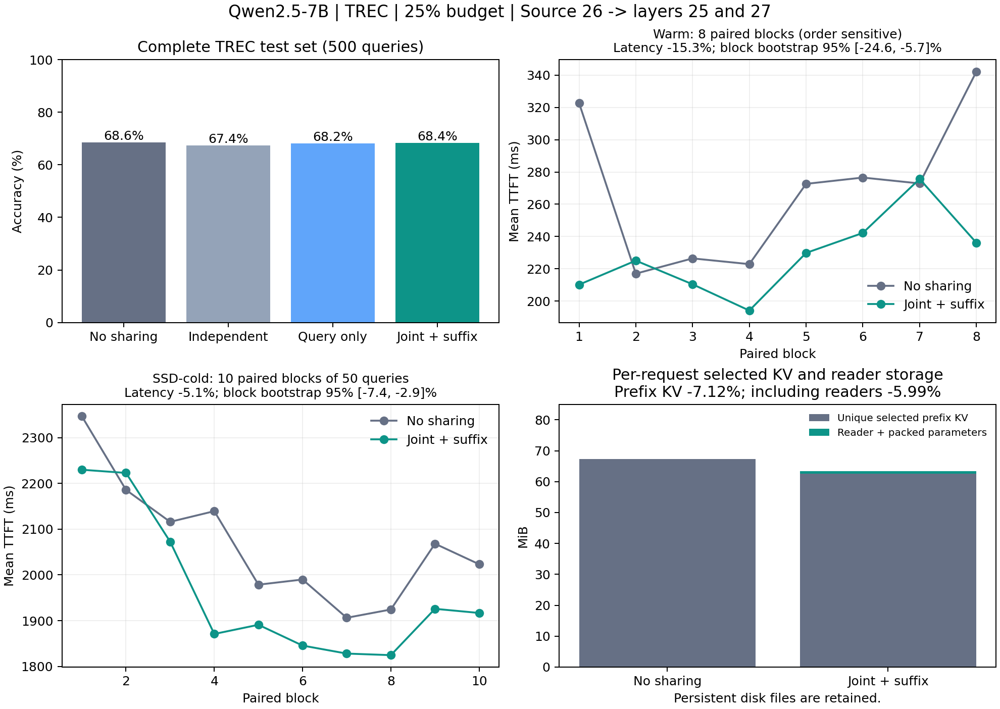

# pans

## LayerKV v2.3：多消费者联合校准与冷缓存实验

本分支基于 [v2.2](https://github.com/utazh/pans/tree/v2.2)（`fddabb7015c66c870a11810069bfbe20d5a34bbf`），发布服务器完成的 v2.3 代码与报告。
第 26 层的 prefix KV 同时供第 25、26、27 层使用；消费者 25、27 各自训练 Q/输出读取变换。当前 query 和生成 token 的 KV 继续逐层独立。
校准使用冻结的真实四层 attention、残差、norm 和 MLP，并包含所有候选标签的实际续写分支。

- [v2.3 发布说明与复现边界](docs/layerkv_v23/RELEASE_ZH.md)
- [完整实测报告](EXPERIMENT_REPORT_V23_ZH.md) · [服务器运行说明](README_LAYERKV_V23_SERVER.md)
- [结果与配对统计](docs/layerkv_v23/results/v23_final_analysis.json) · [校准报告](docs/layerkv_v23/calibration)
- [验证记录](docs/layerkv_v23/validation) · [源码与数据审计](docs/layerkv_v23/audit)

Qwen2.5-7B-Instruct，25% 精确块预算，TREC 完整官方测试 500 条：

| 指标 | 优化后无共享 | 联合共享 |
|---|---:|---:|
| 准确率 | 68.60%（343/500） | 68.40%（342/500） |
| SSD 冷缓存平均 TTFT，完整500条 | 2067.87 ms | 1962.81 ms |
| 普通缓存平均 TTFT，8轮×同32条 | 269.15 ms | 227.92 ms |

冷缓存 TTFT 平均下降 **5.08%**，配对批次 bootstrap 95% 区间为下降 2.87%～7.35%；1000个正式请求均通过逐请求冷状态验收。
所选 prefix KV 减少 **7.12%**，计入 reader 与 packed 参数后该部分净减少约5.99%。
普通缓存虽然平均下降15.32%，但顺序敏感，共享先运行的子组区间跨零，**尚未证明顺序无关的稳定加速**。
准确率下降0.2个百分点，未通过预设非劣验收；开发集下降3.125个百分点，因此没有继续扩大至14/7/4物理source。
所有 reader 仍为 diagnostic-only；500条是历史上已观察的回归数据，服务器也非整机独占环境。



算法、入口和测试文件与服务器实验版本逐字节一致。模型、checkpoint、原始数据、KV cache 和大型 profiler 文件保留在服务器。
历史版本说明如下；本分支优先使用 v2.3 发布说明。

## LayerKV v2.2：GQA 组对齐

本分支 v2.2 基于 v2（b48c45d），发布最新头对齐代码与服务器实测报告。
新增按真实读取误差搜索 4×4 GQA 组匹配、24 种一对一排列、等条件校准及 200 步 reader 蒸馏。
运行时只路由短 Q、prefix 输出和 LSE，保持 source K/V 物理共享及当前 query/generated KV 逐层独立。

- [v2.2 发布说明与变更](docs/layerkv_v22/RELEASE_ZH.md)
- [完整实测报告](EXPERIMENT_REPORT_V22_ZH.md)
- [方法与运行说明](README_HEADALIGN_V22.md) · [服务器运行记录](README_LAYERKV_V22_SERVER.md)
- [结果摘要](docs/layerkv_v22/results) · [校准报告](docs/layerkv_v22/calibration) · [验证记录](docs/layerkv_v22/validation)

本轮局部平均误差下降，但未观察到分类准确率收益或头对齐带来的稳定加速。
18→19：同编号 68.00% / 249.0 ms，头对齐 66.86% / 273.3 ms；
26→27：同编号 72.00% / 301.7 ms，头对齐 71.43% / 278.5 ms。
准确率来自此前已观察过的 175 条 TREC 回归数据；TTFT 来自同一 32 条请求的四轮配对计时。
不同轮次的绝对 TTFT 不直接比较。所有 reader 仍是 diagnostic-only 候选。


## LayerKV v2（SharedKV v2.1 实验实现）

本分支 v2 基于已发布的 v1（59312f2），对应服务器最新完成的 SharedKV v2.1 实验。
当前层独立计算 Q 和当前 query 的 K/V；历史 prefix 使用物理共享 K/V，并通过层专属 Q/输出变换近似原层行为。

- [v2 发布说明与复现边界](docs/layerkv_v2/RELEASE_ZH.md)
- [运行与校准说明](README_LAYERKV_V21.md)
- [完整实验报告](EXPERIMENT_REPORT_V21_ZH.md)
- [轻量结果快照](docs/layerkv_v2/results) · [审计](docs/layerkv_v2/audit) · [验证日志](docs/layerkv_v2/validation)

Qwen2.5-7B / TREC：独立 175 条 holdout；TTFT 为四轮配对测量。
原系统为 70.29% / 274.0 ms，优化后无共享为 70.86% / 203.6 ms，
单对共享 26→27 为 72.00% / 206.9 ms，三对共享为 69.14% / 206.9 ms。
运行时优化带来主要延迟收益；尚未证明跨层共享本身稳定加速。
所有新 reader 仍为 diagnostic-only 候选，未通过严格局部误差门限。


## LayerKV v1

跨层共享 prefix K/V 的最新研究实现见 [运行说明](README_LAYERKV.md) 与 [实测报告](EXPERIMENT_REPORT_ZH.md)。当前 query/生成 token 的 KV 仍逐层独立。严格校准门限默认开启；报告中的共享配置为诊断实验，尚未证明稳定加速。


固定 P8 的 ProMixed KV 选择、缓存与 TTFT 实验代码。当前版本对应第四轮 host gather 与元数据优化。

- 模型：Qwen2.5-7B-Instruct；BF16 计算、FP16 KV。
- 选择层：0 / 8 / 16 / 24；固定 P8；coverage=0.5；关闭自适应 coverage。
- 精确全局块预算：5%、10%、25%、50%；GPU / CPU KV 缓存：55 / 131 MiB；staging 上限 8 MiB。
- 数据集：SST2、SUBJ、TREC、RTE。strict 评测集分别为 867、998、495、272 条，共 10,528 次四预算评测。
- 本轮改动：CPU 源块批量 gather 至 pinned slab；映射数组与选择元数据复用；来源统计在消费时读取最新驻留状态。

[安装与复现](docs/REPRODUCE_ZH.md) · [实验结果](reports/ROUND4_OPTIMIZATION_REPORT_ZH.md) · [上传版本说明](docs/PUBLICATION_ZH.md) · [第三方说明](THIRD_PARTY_NOTICES.md)

## 快速开始

Python 3.10、Linux、NVIDIA CUDA GPU。先安装适合驱动的 PyTorch；实测版本为 2.10.0+cu130。

```bash
python -m venv .venv
source .venv/bin/activate
python -m pip install torch==2.10.0 --index-url https://download.pytorch.org/whl/cu130
python -m pip install -r requirements-dev.txt
python -m pip install --no-deps -e .
python -m pytest -q
```

GPU 测试验证异步传输、尾块与缓存释放后的存储生命周期；没有 CUDA 时这些测试会跳过。发布前在服务器验证：307 tests、87 subtests 通过，保留一项既有只读 memmap 警告。

准备好模型、strict bundle、prefix store、chunk-16 Pcache 和 K4 索引后：

```bash
export PANS_MODEL_PATH=/path/to/Qwen2.5-7B-Instruct
export PANS_BUNDLE_DIR=/path/to/paper_task_bundles_full_eval_strict
export PANS_STORE_ROOT=/path/to/prefix_store
export PANS_PCACHE_DIR=/path/to/pcache_c16
export PANS_SELECTOR_INDEX_DIR=/path/to/selector_index_k4_g32
CUDA_VISIBLE_DEVICES=0 OMP_NUM_THREADS=4 python scripts/run_round4.py \
  --task trec --budget 25 --period 8 --warmup 32 --output results/trec25
```

模型、数据集、缓存和原始 profiler 文件不随 Git 仓库分发，准备步骤见复现文档。所有输出目录须位于仓库内且首次运行时不存在。

## 结果与测量边界

第四轮与第三轮历史完整运行比较：按当前样本构成加权的平均 TTFT 为 **235.91 → 226.84 ms（下降 3.85%）**，9 组变快、7 组变慢；该加权数仅是工程汇总，不是跨任务准确率指标。

同期交替顺序对照的平均 TTFT 改善：TREC 25% 为 13.7%、TREC 50% 为 21.4%、RTE 50% 为 9.1%、SST2 10% 为 9.7%；RTE 5% 基本持平。完整 10,528 条预测、选择结果、预算、评分更新计数和标签 logits/logprobs 均逐项一致。

TTFT 使用 logits-ready 边界，不含模型/索引预载、tokenizer 和服务排队。正式计时不启用 profiler；32 份诊断采集与正式计时分开。服务器不是独占环境，不提供统计显著性结论。详见 [16 组完整对比](reports/round4/comparison.csv) 和 [时间线](reports/round4/timelines)。

## 目录

|目录|用途|
|---|---|
|src/contiguous_fuxian|选择、缓存桥接与 Qwen 运行实现|
|vendor/flexgen|既有 FlexGen / Pcache 相关实现及本地修改|
|scripts/run_round4.py|当前单配置入口|
|scripts/round4_workflow.py|16 组完整实验和 32 份 profiler 采集|
|scripts/profiling|Nsight、VizTracer 分析与时间线生成|
|configs|实验配置与 strict UID 排除规则|
|tests|单元测试与回归测试|
|audit/round4_baseline|同期对照所需第三轮源代码参考快照|
|reports|实验汇总、校验记录与轻量时间线|

其余历史脚本保留用于结果追溯，部分带有旧实验的路径或默认参数。复现当前方案请以 `run_round4.py` 和本文档为入口。
